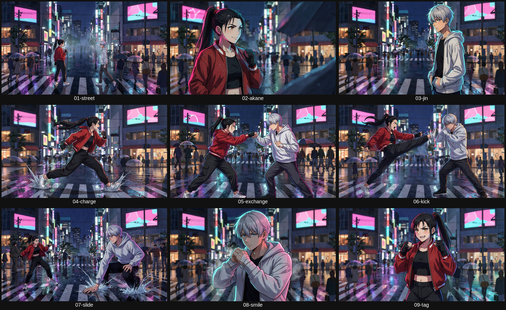

# Make an anime with free models

A test of [makevoid/claude-make-an-anime](https://github.com/makevoid/claude-make-an-anime) with every paid model
replaced by a free, open one. The result is **Scramble**, a 20-second street fight at a rainy Tokyo crossing:
[`results/scramble-final.mp4`](results/scramble-final.mp4).

Nothing was paid for. The heavy models ran on Kaggle's free T4 GPU. The pipeline itself, its file layout, its plan
approval, its review tools, its subtitle and mixing steps, is the upstream one. The installer adds one line to its
loader and a short block to its Rakefile, and changes nothing else.



## What replaced what

| Stage | Paid model upstream | Free model used | Where it ran |
|---|---|---|---|
| Character and location sheets | GPT Image 2.6 | Z-Image Turbo | Kaggle T4 |
| Keyframes from the sheets | GPT Image 2.6 edit | FLUX.2 Klein 4B with reference images | Kaggle T4 |
| Shots | MiniMax H3 Max | Wan 2.2 image-to-video 14B, int8, Lightning LoRAs, 4 steps | Kaggle T4 |
| Voices | ElevenLabs Eleven v4 | Qwen3 TTS VoiceDesign | Kaggle T4 |
| Score | ElevenLabs Music v2.5 | ACE-Step 1.5 | Kaggle T4 |
| Sound effects | ElevenLabs SFX v3 | Stable Audio 3 Small SFX | Kaggle T4 |
| Dialogue check | Whisper on Fal | faster-whisper | Local CPU |
| Titles, subtitles, mixing | local | unchanged | Local CPU |
| Finishing VFX | Swift Core Image, macOS only | not run on Linux | skipped |

All the Kaggle models run through [WanGP](https://github.com/deepbeepmeep/Wan2GP) in headless mode, pinned to one
commit. WanGP handles downloads and fits each model into the T4's 16 GB.

## How it works

The upstream pipeline talks to Fal through one small Ruby class, `Fal::Client`. The free backend replaces that class's
five network methods and nothing else:

1. `backend/lib/free/client.rb` is prepended onto `Fal::Client` when `MV_BACKEND=free`. A request whose result is already
   on disk is answered at once. Speech recognition runs locally. Every GPU request is written to a queue and the step
   stops with "queued".
2. `backend/tools/python/free_backend.py` turns the queue into WanGP tasks, pushes one private Kaggle kernel, waits, and
   stores each result in the shape the pipeline expects.
3. The same `gen:*` task is run again and finds its results, exactly as it would after a Fal call.

A queued request can depend on another queued request. Keyframes can be queued against sheets that do not exist yet,
and shots against keyframes, so one Kaggle session can run a whole chain.

## Run it

```bash
git clone https://github.com/makevoid/claude-make-an-anime
```

```bash
ruby claude-make-an-anime/skills/make-an-anime/scripts/mv.rb init --project "$PWD/project" --story "$PWD/scramble/story.md"
```

```bash
ruby project/mv.rb --project "$PWD/project" setup
```

```bash
./setup.sh project
```

```bash
cp -r scramble/config scramble/prompts scramble/docs project/
```

```bash
source free.env
```

```bash
(cd project && ruby mv.rb --project "$PWD" "fonts:copy[config/fonts.json]")
```

```bash
(cd project && NOTE="your own words approving docs/PLAN.md" ruby mv.rb --project "$PWD" plan:approve)
```

The pipeline refuses to generate anything until the plan is approved, free backend or not.

`KAGGLE_API_TOKEN` must be set, and the Kaggle account must be phone-verified so that GPU and internet are allowed.
On Linux the p5 renderer needs a Chromium wrapper that passes `--no-sandbox`. `setup.sh` writes it when it finds a
Chromium, or set `CHROME_BIN` to yours first.

Then, inside `project/`, each stage is queue, run on Kaggle, generate:

```bash
RUN=char-akane-v2 ruby mv.rb --project "$PWD" "free:queue[ref_base]"
```

```bash
ruby mv.rb --project "$PWD" free:kaggle
```

```bash
RUN=char-akane-v2 ruby mv.rb --project "$PWD" gen:ref_base
```

`free:queue` accepts `ref_base`, `dialogue`, `music`, `keyframes`, `shots` and `sfx`. Queue as many steps as you like
before one `free:kaggle`. `KAGGLE_ARGS="--only image,edit"` runs only some kinds and leaves the rest queued.

## What the test measured

One clean pass of the 20-second film needs three Kaggle sessions and about 2.1 hours of T4 time.

| Session | Work | Time |
|---|---|---|
| 1 | 3 sheets, 5 voice lines, 3 music cues, 7 sound effects | 18 min |
| 2 | 3 sheets again, 9 keyframes | 28 min |
| 3 | 9 shots, 29 seconds of footage in all | 78 min |

Each session spends 4 to 5 minutes installing WanGP. Video is the cost: about 7 minutes per shot at 832x480.

The whole test used 4.1 hours of quota, because one session was wasted. See "What went wrong".

## Quality against the paid demos

**As good as the paid pipeline**

- **Sheets.** Z-Image Turbo draws a clean multi-view character sheet in one try once the prompt is right.
- **Character consistency.** FLUX.2 Klein kept both characters' faces, hair and outfits across all nine keyframes from
  the reference sheets, on its first attempt. This was the stage expected to be weakest.
- **Voices.** All five Japanese lines were heard word for word by speech recognition, with fitting lengths.

**Weaker than the paid pipeline**

- **No lip-sync.** MiniMax H3 animates the mouth from the voice track. Wan image-to-video cannot. Mouths move because
  the prompt says the character speaks, not in time with the words.
- **Resolution.** Shots are 832x480 at 16 fps, repeated to 24 fps and upscaled to 1080p. The film is visibly softer
  than the 768P-to-1080p paid demos.
- **Camera variety.** Every keyframe shows the same view of the crossing, with the same pink screens, whatever
  direction the camera should face. Klein copies the location painting closely.
- **Invented signage.** The tracking shot shows neon signs with pseudo-lettering, despite "no text" in the prompt.
- **Framing drift.** In the punch exchange the camera arc pushes Jin partly out of frame near the end.

**Not judged.** Nobody has listened to the score, the effects or the voice acting. Levels were measured and are not
silent or clipped, but taste needs ears.

No shot was retaken. The upstream demos were made with several retakes per film, so this is a first-pass result.

## What went wrong

- **Hugging Face free GPU is too small.** Free hosted demos gave a perfect sheet and a video clip, but the daily quota
  ran out after about ten calls. It cannot carry a film.
- **Kaggle queued for 55 minutes once.** Quota was fine and nothing else was running. A trivial GPU kernel queued the
  same way, so it was GPU availability. Later sessions started at once.
- **The first sheets leaked the style bible.** The style paragraph mentions neon streets and martial arts, so the sheets
  got a street backdrop and the location got a fighter painted into it. Sheets now carry their own short style line.
- **One video model does not run on a T4.** The merged "Enhanced Lightning v2" checkpoint is FP8-only and has to be
  emulated. Its first clip did not finish one denoising step in 95 minutes. The session was deleted to stop it, which
  also lost that session's sheets and keyframes, because Kaggle only keeps the files of a finished run. This cost about
  2 hours of quota.
- **Fixes that came out of it.** Video uses the int8 model with Lightning LoRAs. A slow-risk model now runs its first
  task alone under a time limit and hands over to a proven fallback when it is too slow. Stages can run as separate
  sessions so finished work is saved first. A running kernel's log can be streamed with `kaggle kernels logs -f`.

## Linux notes

The upstream toolkit is written on macOS. These were needed here, and `setup.sh` and `free.env` cover them:

- ImageMagick 6 has no `magick` command, so `setup.sh` adds a small wrapper.
- `LC_ALL=C.UTF-8`, or Ruby fails on non-ASCII prompts.
- `MEDIA_FONT` and `config/fonts.json` must point at fonts that exist on the machine.
- Headless Chromium needs `--no-sandbox` when run as root.
- The pipeline's believability check reads "rain running down her jacket" as a person running. The `believable:` field
  in the shot records why it is fine.

## What is here

| Path | Contents |
|---|---|
| `results/scramble-final.mp4` | The film, with sound effects |
| `results/scramble-clean-no-sfx.mp4` | The film without sound effects |
| `results/sheets/` | Character and location sheets, rejected v1 beside accepted v2 |
| `results/keyframes/`, `results/keyframes-board.jpg` | The nine first frames |
| `results/contact-sheet.jpg` | Frames across the finished film |
| `scramble/` | Story, style bible, cast, every prompt and the approved plan |
| `backend/` | The free backend: Ruby client, rake tasks, Python worker, Kaggle kernel script |
| `setup.sh`, `free.env`, `sync.sh` | Installer, Linux environment, copy-back helper |

## Where to take it next

- **Lip-sync.** WanGP also carries InfiniteTalk and open MiniMax H3 variants that take a voice track. Neither has been
  tried here, and both are heavier than what ran.
- **Sharper picture.** WanGP's FlashVSR or SeedVR2 upscalers, or 720p generation for hero shots.
- **Retakes.** The establishing shot was asked to be a high wide view and came out at street level.
- **Licences.** Check each model's licence before commercial use. They were not reviewed for this test.
