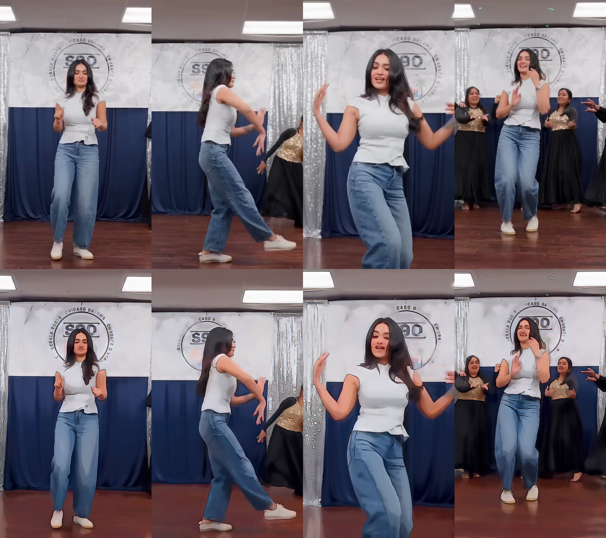

# Anime re-render of the dance clip

`output/dance_anime.mp4` is the uploaded clip (720x1280, 30 fps, 53.1 s, 1594 frames)
redrawn in an anime cel style. Every frame, the camera move, the timing and the audio
match the source. Only the drawing style changes.



## How it was made (CPU only, no GPU)

1. **Neural stylisation.** Each frame goes through AnimeGANv3 "large Ghibli"
   (`AnimeGANv3_large_Ghibli_c1_e299.onnx`) at full resolution (padded to 736x1280).
   Eight models were tested (AnimeGANv2 Hayao, Shinkai and Paprika, AnimeGANv3 JP-face,
   portrait-sketch, face-paint v2, and others; see `look/model_shootout.jpg`). This one gave
   the cleanest cel look with ink outlines and kept the dancer recognisable.
   The JP-face model looked more "anime" but bleached her skin tone, so it was rejected.
2. **Grade back onto the source palette.** The raw model output has a strong orange cast
   and lightens skin (`look/model_raw_vs_graded.jpg`). In Lab space the final frame keeps
   the *source's* low frequencies (lighting, skin tone, garment colours) and takes the
   *model's* high frequencies (outlines, flat cel shading, simplified detail).
3. **Anime finish.** Soft posterised two- and three-tone shading (`--cel 0.6`), a
   difference-of-Gaussians ink line pass, +20 % saturation and a light highlight bloom.
4. **De-flicker.** Per-frame GANs shimmer. DIS optical flow warps the previous output onto
   the current frame and blends it at up to 70 %. A motion-error mask turns the blend off
   where pixels really changed, so fast arm swings do not ghost
   (`look/deflicker_fast_motion.jpg`; top row is raw, bottom row is de-flickered).
   Mean frame-to-frame change on the fastest section drops from 8.0 to 7.0.
5. **End card untouched.** Frames 1474 onward (49.13 s, the "BLACK" logo card) pass
   through unchanged so the logo stays crisp.
6. **Encode.** H.264 CRF 17 with the source audio (Opus re-encoded to AAC 192k), with faststart.

Stage timings on 4 vCPUs: stylisation took about 37 min (2 workers x 2 threads,
about 1.5 s per frame); grading, de-flicker and encode took about 8.5 min.

## Re-run

```bash
pip install numpy onnxruntime opencv-python-headless
anime/scripts/render.sh input.mp4 anime/output/dance_anime.mp4 1473   # 1473 = last stylised frame
```

Frames and the model download go to `anime/work/` (git-ignored). Stage 1 can be resumed.
Look knobs live in `scripts/stage2_compose.py`: `--cel`, `--lines`, `--sat`, `--bloom`,
`--alpha` (de-flicker strength) and `--sig` (how much tone comes from the source).

## Notes

- HyperFrames (HTML-to-video) was not needed. This is a per-frame style transfer of live
  footage, not a motion-graphics build.
- AnimeGANv3 weights are released by their author for non-commercial use. Commercial use
  (e.g. a paid brand post) needs the author's permission. See
  https://github.com/TachibanaYoshino/AnimeGANv3.
