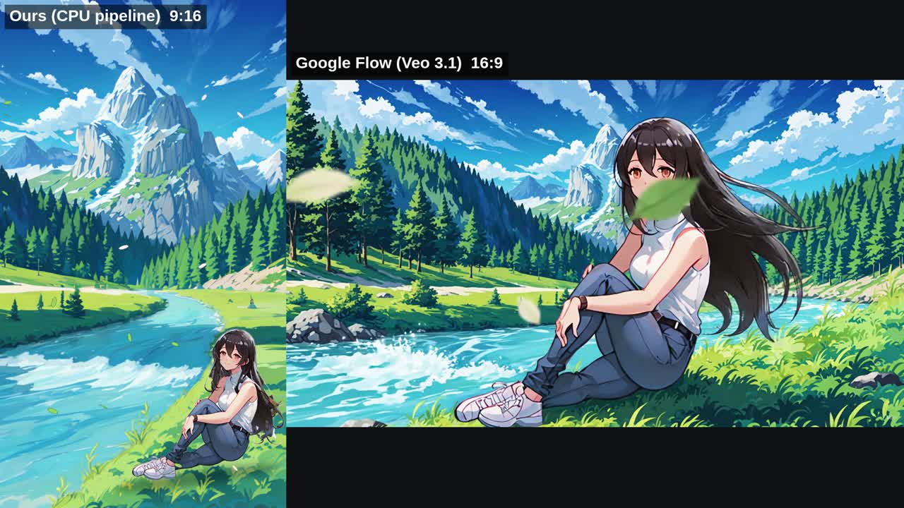

# Ours vs Google Flow: girl by the river

`comparison_side_by_side.mp4`: ours on the left (first 7.9 s), Flow on the right, with Flow's audio.

| | Ours (CPU pipeline) | Google Flow (Veo 3.1) |
|---|---|---|
| Format | 1080x1920 (9:16), 30 fps, 10 s | 1280x720 (16:9), 24 fps, 7.9 s. Portrait was not applied |
| Character vs reference | Exact (it is the reference drawing) | Very close: outfit, belt, watch, sneakers, hair and pose all kept. Skin a bit lighter |
| Character acting | Hair only. No blinks, no head or body motion | Turns from the mountain to the camera and smiles, with strong natural hair motion |
| River | Flows, with glints. Slight smearing near the banks | More convincing splashes and foam |
| Wind and leaves | Small flat leaves | Large leaves with depth and motion blur past the lens |
| Camera | Slow push-in | Cinematic arc |
| Landscape vs our image | Exact | Reinterpreted: smaller peak, river behind her, more forest |
| "Naruto-like" look | Soft shoujo/Shinkai painting | Crisper, bolder lines and more saturated, but still modern-anime shading rather than flat 2000s cels |
| Stability | No flicker; every motion is a warp of one drawing | Stable over 8 s, no visible face drift |
| Control | Every motion is adjustable and repeatable, and can loop | Re-prompt or regenerate |
| Cost | About 1.5 h on 4 CPUs, free | About 1-2 min, uses Flow credits |

**Verdict.** Flow wins on performance and cinematic feel: the head turn, the smile and the wind all read as real
animation. Ours wins on exact fidelity to the chosen landscape and character drawing, on the vertical format, and
on control.

**Best of both.** Use Flow's Frames to Video with `start_frame.png` and Portrait 9:16 set explicitly. That keeps
our exact scene and adds Flow's character acting.
