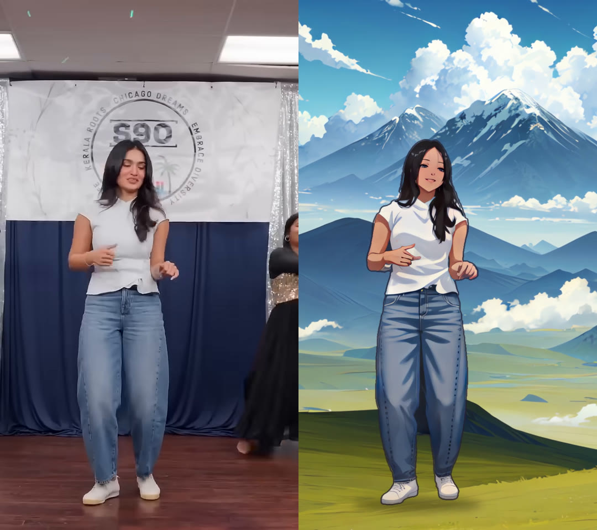

# 5-second shoujo-anime cut, mountain background

`../output/dance_anime_mountains_5s.mp4`: 0:05 to 0:10 of the uploaded clip (720x1280, 30 fps,
150 frames, original audio). Only the dancer is redrawn as a shoujo-anime character. The stage is
replaced with an anime mountain landscape.

## Pipeline (CPU only)

1. **Cut out the dancer** (`seg5_prep.py`, `birefnet_frames.py`). MODNet (ONNX, Apache-2.0) runs on
   every frame, unioned with BiRefNet-lite (ONNX, MIT) on the drawn frames, where MODNet went
   transparent on motion-blurred legs. A connected-component tracker keeps only the main dancer, so
   the other dancers at the frame edges are dropped.
2. **Camera motion**. ORB features on the stage background (dancer masked out) give a per-frame
   similarity transform. The handheld camera drifts about 60 px and zooms about 6 % over the 5 s.
3. **Mountain plate** (`gen_plate.py`). MeinaMix V11 txt2img, 22 steps, seed 8 (`look/mountain_plate.png`),
   with an open grass foreground for her to stand on. It is upscaled with Real-ESRGAN animevideov3,
   overscanned 14 % and moved with the source camera every frame (`seg5_comp.py`). A soft contact
   shadow sits under her feet.
4. **Anime character** (`sd_seq.py`). The dancer is composited over the plate, then redrawn on a
   512x1104 crop at native resolution with MeinaMix V11, lineart ControlNet and LCM-LoRA (6 steps, bf16).
   Drawings are made on twos (15 per second). Each drawing starts from the previous one warped by
   optical flow (strength 0.6; the first frame uses 0.85) with a fixed seed. Broad colour is re-anchored
   to the source each time, so skin tone and clothes do not drift (`look/consistency_strip.jpg`).
5. **Final composite** (`seg5_final.py`). Each drawing is upscaled with animevideov3. Only the inside of
   the dancer is taken from the drawing (matte eroded 2 px), with a dark ink line drawn along her
   silhouette, over the clean moving plate. Each drawing is held for 2 frames. Encoded as H.264 CRF 17
   with `-tune animation`.

Rendering took about 40 min for the 75 drawings plus about 15 min for matting, plates and the encode, on 4 vCPUs.

## Notes

- 0:05 to 0:10 was chosen because she faces the camera and dances full-body. In 0:00 to 0:04 she
  walks away with her back turned. Change `150 299` in the commands to use another window.
- MeinaMix and the lineart ControlNet are CreativeML OpenRAIL-M. LCM-LoRA is OpenRAIL++.
  Real-ESRGAN is BSD-3.
