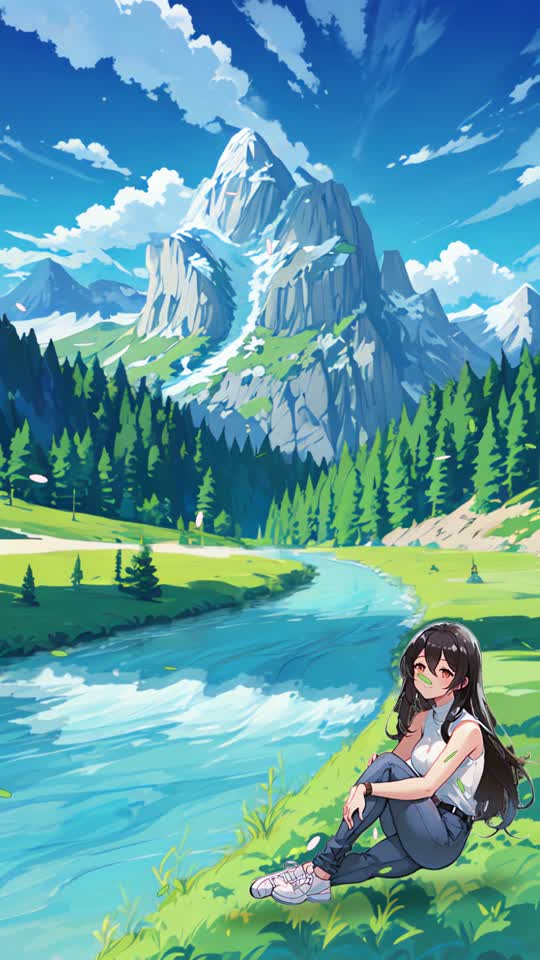

# Girl by the river: animated anime scene

`../output/girl_by_the_river.mp4` is 1080x1920, 30 fps, 10 s, with a synthesized river and wind ambience.
The girl from the 5-second dance cut sits on the riverbank of the anime landscape made from the
GeologySeeker Short's thumbnail. The river flows, wind moves her hair and the leaves, the distant pines
sway, the grass ripples and the clouds drift.

## How it was made (CPU only)

1. **Landscape** (`landscape_preview.py`). MeinaMix V11 img2img with lineart ControlNet and LCM-LoRA
   from the Short's thumbnail (seed 1234), upscaled with Real-ESRGAN animevideov3 to 1080x1920.
2. **The girl, sitting** (`gen_sitting.py`). MeinaMix V11 txt2img with IP-Adapter Plus (scale 0.55),
   using a crop of her earlier anime drawing (matted onto white) as the reference. That keeps her face,
   long black hair, sleeveless white mock-neck top, watch, jeans and white sneakers. Seed 505 of 8 candidates
   was used (`look/girl_candidates.jpg`). She was matted with BiRefNet-lite, upscaled, mirrored to face the
   river, and placed on the right bank (`river_scene.py`).
3. **Animation** (`river_anim.py`). Every motion is a displacement of the still image, so the drawing
   never flickers:
   - **River**: a flow field follows the river's centreline, faster towards the viewer. Two half-period-offset
     advections are cross-faded for continuous flow, and a texture inpainted past the banks keeps edge samples
     watery. Glints drift with the current.
   - **Hair**: a travelling wave runs along the strands, weighted by distance from the crown, so the roots stay
     put and the tips move most. Face, arms and top are excluded. Gaps between strands are filled with the base
     hair colour so nothing flickers through.
   - **Distant pines** shear about their bases in a gust that rolls across the forest. **Grass** ripples, more
     strongly nearer the camera. **Clouds** drift above a traced mountain skyline (`look/motion_masks.jpg`).
   - Wind-blown leaves and petals, a contact shadow under her, a jeans tint matching the original light wash,
     and a slow 3.5 % push-in.
4. **Ambience**: pink noise band-passed for the river and brown noise with slow tremolo for the wind,
   at -22 LUFS.

Render: about 1.5 min for 300 frames.
