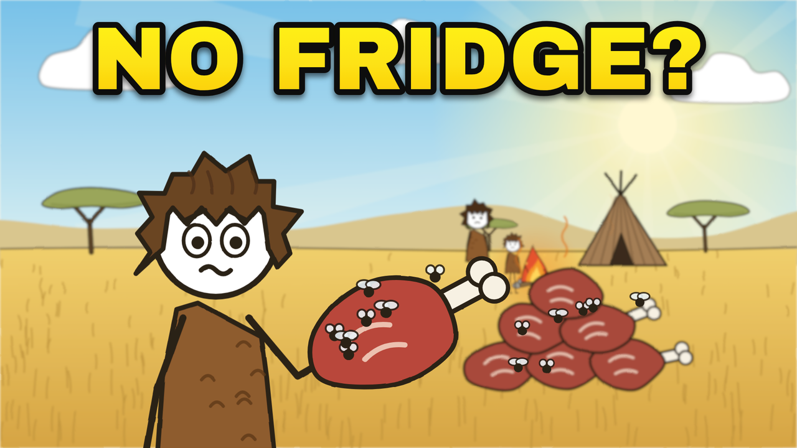
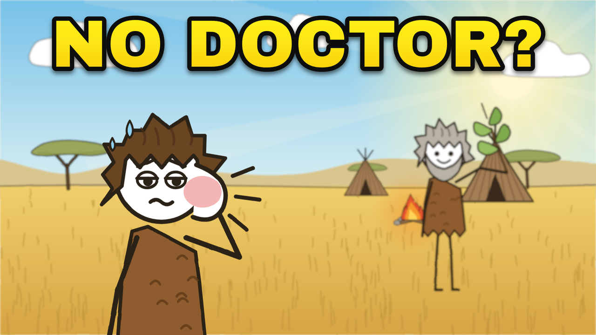
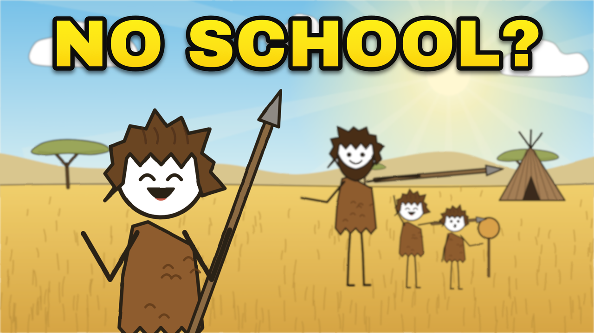
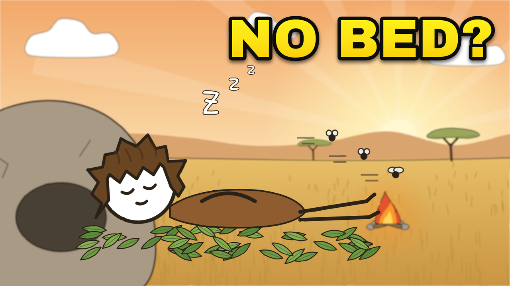

# Channel plan: titles, thumbnails and the next videos

Based on the Max cro channel's numbers and thumbnails (measured 2026-11-11) and the
1of10 "YouTube Intelligence Report" newsletter of November 2026 (11,362 outlier videos).

## 1. What the reference channel shows

The channel is seven weeks old. Two of its four long videos carry almost everything.

| Uploaded | Length | Views | Views/day | Title (Hindi, translated) | Thumbnail text |
|---|---|---|---|---|---|
| Sep 25 | 17:23 | 2,180,000 | 47,400 | What did ancient humans do all day? ⏳ | NO JOBS |
| Oct 8 | 15:47 | 895,000 | 27,100 | How did ancient humans survive Earth's most dangerous predators? 🦁 | SURVIVED HOW? |
| Oct 24 | 8:09 | 20,000 | 1,200 | When and why did humans start wearing clothes? 🤔 | WHY CLOTHES? |
| Nov 4 | 20:50 | 21,000 | 3,500 (6 days old) | What did ancient humans actually do all night? 🤔 ‖ The mystery of ancient humans' nights 😱 | NO SLEEP? |

Its Shorts (4) get 8-17K views each; they are not what grows it.

### Titles

- **Winners start with the subject**, "Ancient humans…", and ask about *daily life* (all day) or *survival* (predators).
- **The flop changes both**: it starts "Humans…" and asks about an *origin* ("when and why did… start"), which is abstract, not a day you can picture. It is also the only short one (8 minutes).
- **One emoji at the end**, matching the topic (⏳ 🦁).
- The newest title adds a second clause after "‖". Too early to judge.

### Thumbnails (measured on the 1280x720 originals)

| | NO JOBS (2.18M) | SURVIVED HOW? (895K) | WHY CLOTHES? (20K) | NO SLEEP? (21K) |
|---|---|---|---|---|
| Text height | 16% of frame | ~20% | 16% | 49% (two lines) |
| Text place | top right | full width, top | full width, top | right middle |
| Text colour | #FCF80B → #FBE20D | #FBF00D flat | #FCE70F → #FBCB10 | #FCD654, pale |
| Outline | black, ~6 px, plus drop shadow | black ~5 px, plus white outer stroke | black ~6 px, plus shadow | **none** |
| Typeface | heavy grotesque (Arial Black type) | heavy rounded | heavy grotesque | thin rounded |
| Hero | huge, left, smug-relaxed | right, worried, a lion stalks him | anime-style woman, naked and shivering vs a modern woman | scared, at night |
| Light | bright day | bright day | split cold/city | **dark night** |

**The winning format:** one big hero from the channel's own character style, one clear emotion,
bright warm daylight, background action that tells the story (people idling at a fire;
a lion in the grass), and two words of heavy yellow capitals with a thick black outline across the top.

**What the flops did differently:** NO SLEEP? is dark, with thin text and no outline,
so it disappears in a feed. WHY CLOTHES? drops the house character for a different art
style, is cluttered (split screen, arrow, question mark), and shows a naked woman, which
YouTube tends to show to fewer people.

### Our thumbnail template

`film/pilot-fridge/thumbs.js` builds thumbnails to that spec: Archivo Black,
yellow #FFF51C → #FBC70F, black outline 13% of the font size, drop shadow, text across the
top at ~16% height; hero head ~28% of frame height, never under the text; daylight
world with sun rays and a slightly blurred background. `node thumb.mjs` renders them all.

| | |
|---|---|
|  |  |
|  |  |

Rules for every new thumbnail:

1. Two words (three at most), ALL CAPS, usually "NO [MODERN THING]?" or "[VERB] HOW?".
2. The text adds to the title; it never repeats it.
3. Our stick-figure hero, big, one readable emotion. No other art styles.
4. Daylight, warm colours. If the topic is night, use dusk or firelight, never a dark frame.
5. Nothing YouTube treats as sensitive: no nudity, no gore, no injury close-ups.

## 2. What the newsletter adds

1of10's study of 11,362 videos that beat their channel's normal views:

- **Long videos win for small channels.** Under 100K subscribers, 58% of long videos doubled the channel's normal views versus 37% of Shorts. Videos of **16-25 minutes** reached new viewers (10x subscriber count) 9.9% of the time, against 5.4% for videos under 6 minutes.
- **Titles about the subject, not the viewer.** Titles with "you/your" were half as common in the videos that broke through (12.7% vs 25%).
- **The breakthrough window is widest now:** at 1-3K subscribers 16.4% of videos broke through; at 15-25K only 3.2%.
- **Formats working at every size:** "Why [subject] [surprising fact]?", "[Number] [things] that [twist]", and "I tested [thing]" (the last doesn't suit an animated documentary).

The reference channel already follows the first two rules (17- and 16-minute hits, "Ancient humans…" titles).
Caveat: the newsletter comes from a company selling strategy calls, and its numbers are correlations.

## 3. Rules for our titles

1. Start with the subject: "How Did Ancient Humans…", "What Did Ancient Humans…", "Why Did Ancient Humans…".
2. Ask about a day you can picture (food, sleep, sickness, kids), or survival. Avoid "when did X start" origin questions.
3. No "you" or "your" in the title. The script can speak to "you"; the title shouldn't.
4. One emoji at the end that matches the topic.
5. Under 60 characters so it isn't cut off on phones.
6. Make videos 16-20 minutes long. Use Shorts only as trailers.

## 4. The slate, in recommended order

Every claim below is from published research, cited from memory; check each source before the script is locked.

### 1. NO FRIDGE? (expand the pilot to a full video)

- **Title:** How Did Ancient Humans Keep Food Without Fridges? 🥩
- **Alternative titles:** "Why Ancient Humans Stored Food Inside Bones" · "5 Ways Ancient Humans Kept Meat From Rotting"
- **Why first:** the style, voice and opening already exist; only the middle needs writing and drawing.
- **Story, 17 minutes:**
  1. *0:00 Hook (done):* the fridge hums; rewind 50,000 years; too much meat, the sun, "Cavemen? They just let it rot. At least, that's what we assume."
  2. *1:30 The problem:* how fast meat spoils, flies, scavengers smelling it, why this was life or death.
  3. *3:00 Trick 1, sun and wind:* thin strips on racks; why drying works (bacteria need water).
  4. *5:00 Trick 2, smoke:* smoke dries the meat and keeps flies off.
  5. *6:30 The bone "tin can":* at **Qesem Cave, Israel**, people 400,000 years ago left deer leg bones in their skin for weeks, then cracked them for marrow that was still fresh (Blasco et al., *Science Advances*, 2019).
  6. *9:00 Trick 3, cold and fermentation:* frozen pits in the north; at **Norje Sunnansund, Sweden**, 9,200 years ago, people fermented fish on a large scale in a sealed pit (Boethius, *Journal of Archaeological Science*, 2016).
  7. *11:30 The first granaries:* at **Gilgal, Jordan Valley**, 11,300 years ago, people built storage houses for wild grain before farming began (Kuijt & Finlayson, *PNAS*, 2009).
  8. *13:30 Twist:* the smartest fridge was other people. The Hadza share big kills across the whole camp; today you give, next week you receive.
  9. *16:00 Callback:* "Your fridge stores food. Theirs stored friendship."

### 2. NO DOCTOR?

- **Title:** How Did Ancient Humans Survive Without Doctors? 🤒
- **Alternative titles:** "Why a 48,000-Year-Old Tooth Held Painkillers" · "5 Ancient Medicines That Actually Worked"
- **Why:** survival plus emotion, the same pull as the 895K predator video.
- **Evidence:**
  - **El Sidrón, Spain**, ~48,000 years: DNA in a Neanderthal's tartar shows that, with a tooth abscess, he had eaten poplar (which contains salicylic acid, the natural ingredient behind aspirin) and *Penicillium* mould (Weyrich et al., *Nature*, 2017).
  - **Villabruna, Italy**, ~14,000 years: a rotten molar scraped out with a sharp flint, the oldest known dental work (Oxilia et al., *Scientific Reports*, 2015).
  - **Riparo Fredian, Italy**, ~13,000 years: teeth drilled and filled with bitumen (Oxilia et al., *American Journal of Physical Anthropology*, 2017).
  - **Shanidar 1, Iraq**: a Neanderthal with a crushed face, a useless arm and failing hearing lived for years after his injuries, so others must have fed and protected him.
  - **Ötzi**, 5,300 years: carried birch polypore fungus, which may have been medicine.
- **Twist:** the oldest medicine wasn't a plant. It was someone sitting with you by the fire.
- **Opening (in the house voice, about 60 seconds):**

  > Tonight, if a tooth starts to throb, you'll reach for a pill.
  > Tomorrow, a stranger in a white coat will fix it.
  > Now take time back fifty thousand years.
  > A man wakes up with his jaw on fire.
  > No pharmacy.
  > No dentist.
  > No painkiller.
  > Now your brain is probably saying,
  > "He just suffered. Or he died."
  > At least, that's what we assume.
  > But in a cave in northern Spain,
  > his teeth kept a secret for forty-eight thousand years.
  > Locked in the plaque on those teeth
  > was a list of what he ate.
  > Poplar bark. The same chemical that's in aspirin.
  > And a mould.
  > The mould that, thousands of years later, would give us penicillin.

### 3. NO BED?

- **Title:** How Did Ancient Humans Sleep Without Beds? 🛏️
- **Alternative title:** "Why Ancient Humans Slept on Bug-Killing Leaves"
- **Why:** a "day in the life" topic like the 2.18M hit, and a different angle from the reference's night video.
- **Evidence:**
  - **Border Cave, South Africa**, ~200,000 years: grass bedding laid on a layer of ash, which may have kept crawling insects away (Wadley et al., *Science*, 2020).
  - **Sibudu, South Africa**, 77,000 years: bedding of sedges topped with leaves of *Cryptocarya woodii*, which contain chemicals that kill mosquitoes; old bedding was burned to clean the floor (Wadley et al., *Science*, 2011).
  - **Today's hunter-gatherers** (Hadza, San, Tsimané) sleep about 6-7 hours, wake with the temperature drop, and two of the three languages have no word for insomnia (Yetish et al., *Current Biology*, 2015).
- **Twist:** their "mattress" was also bug spray, and they spring-cleaned it with fire.

### 4. NO SCHOOL?

- **Title:** How Did Ancient Kids Grow Up Without Schools? 🧒
- **Alternative title:** "Why 13,000-Year-Old Cave Walls Are Covered in Children's Fingermarks"
- **Evidence:**
  - **Rouffignac Cave, France**: finger lines on the ceiling made by children as young as two to five, some lifted up by adults (Sharpe & Van Gelder, *Antiquity*, 2006).
  - **White Sands, USA**: a trail of footprints where someone carried a toddler for over a kilometre, setting the child down now and then (Bennett et al., *Quaternary Science Reviews*, 2020).
  - **Hadza children** forage for a real share of their own food (Crittenden et al., *Human Nature*, 2013).
  - **Babies raised by many hands**: aunts, grandmothers and older siblings, not just the parents (Hrdy, *Mothers and Others*, 2009).
- **Twist:** the classroom was the whole camp, and play was the lesson.

### 5-8. Later

| Thumbnail | Title | Core evidence | Twist |
|---|---|---|---|
| NO LIGHTER? | How Did Ancient Humans Make Fire Without Lighters? 🔥 | Wonderwerk Cave ash, ~1 million years (Berna et al., *PNAS*, 2012); Gesher Benot Ya'aqov, ~790,000 years (Goren-Inbar et al., *Science*, 2004); Neanderthal hand-axes with pyrite strike marks (Sorensen et al., *Scientific Reports*, 2018) | Fire didn't just cook food; one theory says cooking made our brains bigger |
| NO DENTIST? | Why Did Ancient Humans Rarely Get Cavities? 🦷 | Toothpick grooves on Neanderthal teeth from Krapina (Frayer et al., 2017); cavities rose sharply with farming | Bread, not candy, started the cavity boom. Overlaps with NO DOCTOR?, so pick which video gets the dental finds |
| NO BOTTLES? | How Did Ancient Humans Carry Water Without Bottles? 💧 | Engraved ostrich-eggshell flasks from Diepkloof, ~60,000 years (Texier et al., *PNAS*, 2010); the San still bury filled shells for dry seasons | The engravings may be the first "brand", marking whose flask it was |
| FIRST PET? | Did Ancient Humans Have Pets? 🐕 | Bonn-Oberkassel, Germany, ~14,000 years: a puppy with distemper kept alive for weeks by human care, buried with two people (Janssens et al., *Journal of Archaeological Science*, 2018) | Nobody nurses a sick puppy for its usefulness. That was love |

Once five or more are out, a list video fits the newsletter's "[Number] [things] that [twist]" format,
e.g. "7 Ancient Inventions That Still Work Today 🔥", cut from the existing animation.

## 5. Production notes

- Target 16-20 minutes per video: about 3,300-4,000 words and 550-650 shots at the reference's pace.
- Keep the house voice from the pilot: second person in the script, lists of three, sentences split across cuts, the voiced objection, named researchers, a callback ending.
- Make the thumbnail first and judge it at phone size (about 320 px wide) before making the video.
- Optional: Hindi versions. The reference proved that audience; the pipeline can take a Hindi script and voice.

## Lessons from the first analytics (NO FRIDGE?, November 2026)

**What YouTube reported.** About 2,180 impressions, mostly from Suggested videos, but a click-through rate (CTR) of only 1.42%. That gave 69 views, 1 like, 0 comments and 1 share. The channel's stronger long-form videos reach 4.57% CTR (Hachikō) and 3.73% (tariffs). Retention was strong. The problem is packaging and engagement, not the content.

**Why.** The title was published as "7 Ways Ancient Humans Kept Food From Rotting". That reads as a listicle, not a survival story. The best hooks were hidden: 300,000 years without a fridge, meat sealed in bone, and friendship as a food bank. The thumbnail looked generic, and nothing in the video asked viewers to comment.

### Title rules v2 (replace the old title rules)

1. **Story, mystery or a hard number. Never a listicle.** No "7 ways", "5 facts" or "top 10".
2. **Proven shapes:**
   - "How Humans [survived/did X] for 300,000 Years Without [modern thing]"
   - "What Did Humans Do Before [X] Existed?"
   - "The [number]-Year-Old [object] That [surprise]"
   - "Why [people] [did something unexpected]"
3. **Put the strongest hook from the script into the title.** If the script's best moment isn't in the title or thumbnail, fix the packaging, not the script.
4. **Emoji are optional.** Test with and without; the channel's best performers have none.
5. **Upload with three titles in YouTube's Test & compare.** If CTR is below 3% after 48–72 hours, swap the title and thumbnail.

### Thumbnail rules v2 ("contrast split", replaces rules 3–4 above)

1. **Split frame.** Left: a dark navy panel with the glowing modern object (fridge, pills, phone-lit bed, classroom, temple, parliament, ring). Right: a bright ancient scene. The two halves are divided by a jagged white edge.
2. **The hero is big on the right, with one strong emotion.** Put the story prop in view (marrow bone, swollen cheek, glowing eyes, Lion Man, crowned bully).
3. **One red circle, on the single thing that makes people curious.**
4. **Text is short and across the top.** The main thumbnail says "NO [X]?". The alternate uses a hard number or a mystery ("300,000 YEARS", "18 MINUTES", "31,000 YEARS").
5. **Check it at phone size** (about 320 px wide) next to real competitors before uploading.

Code: `film/pilot-fridge/thumbs.js`, entries `*V2` (main) and `*V2b` (alternate). Render with `node thumb.mjs fridgeV2 …`.

### Engagement rules (every video from now on)

1. **Ask a specific either/or question in the video, twice.**
   - Once, lightly, around the middle.
   - Once just before the final callback, on a "comments" card (`commentPrompt` scene).
   - Example: "Which custom surprised you most: bride service, the mother-in-law language, or walking marriage?"
2. **Pin the same question as the first comment** (`pinned_comment.txt` in each kit) within minutes of publishing.
3. **Reply to and heart comments in the first hours.** Early discussion is what pushes a video into home feeds.
4. **Surface the single most surprising fact in the first 30 seconds,** for example "friendship as a food bank".

### Targets to watch in Studio (first 48 hours)

- CTR of 4% or more.
- Average view duration at least as long as now.
- At least one comment per 100 views.
