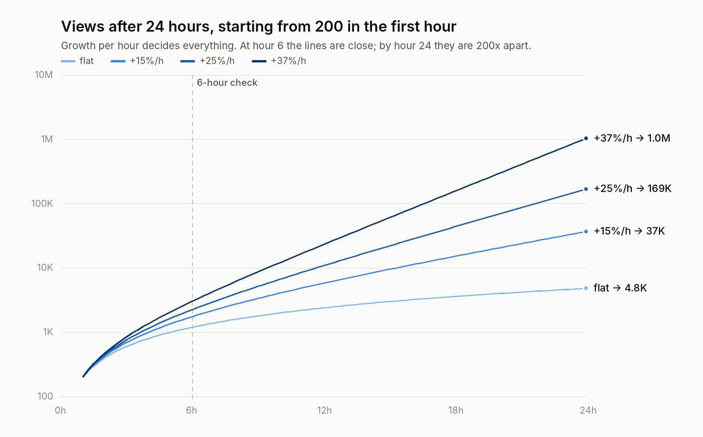

# The maths of a reel going viral in 24 hours

Instagram doesn't publish its ranking formula, so nobody can give you the real one. What follows is a **model**, the same kind epidemiologists use for how things spread. It explains why reels either stall or explode, and it's calibrated with public benchmarks and the real @wealth numbers in `reference/`. Use it to set targets and to read your own reel's first hours.

**Confirmed by Instagram:**
- Adam Mosseri says the top three ranking signals are **watch time, likes and sends**.
- Sends count more with people who don't follow you.
- More and more reach comes from recommendations.
- Trial Reels show a reel to non-followers first and widen it if it performs.

**Assumed by the model:** that distribution grows or shrinks round by round depending on how the last round performed. That's the widely described pattern, but Instagram hasn't confirmed the mechanics.

## 1. The one equation

Say your reel gets **v₁** views in its first hour, and each hour after that gets **g** times the views of the hour before. After *t* hours:

```
total views = v₁ × (gᵗ − 1) / (g − 1)
```

**g is everything.** Here is what it takes to hit a target in 24 hours:

| First-hour views | 100K in 24 h | 1M in 24 h | 10M in 24 h |
|---|---|---|---|
| 100 | +26% per hour (doubling every 3.0 h) | +41% per hour (every 2.0 h) | +58% per hour (every 1.5 h) |
| 300 | +19% per hour (every 4.0 h) | +34% per hour (every 2.4 h) | +50% per hour (every 1.7 h) |
| 1,000 | +11% per hour (every 6.7 h) | +26% per hour (every 3.0 h) | +41% per hour (every 2.0 h) |

**A million views in a day, starting from a normal first hour, means views keep doubling about every 2 hours for 24 hours straight.**



Look at hour 6 on the chart: the flat reel has 1.2K views and the 1M reel has 3.0K. That's only 2.5x apart. By hour 24 they're 200x apart. **Early numbers look ordinary even on reels that go viral.** What matters is whether each hour beats the last.

## 2. Why viral is a threshold, not a scale

Think of distribution in rounds. Instagram shows the reel to a test group, measures it, then shows it to **m** times as many people in the next round. m is the reel's spread factor, like the R number of a virus.

```
m below 1:   the reel shrinks every round and stops at   test group ÷ (1 − m)
m above 1:   the reel grows every round with no ceiling until it runs out of interested people
```

With a test group of 300 and 12 rounds in a day:

| Spread factor m | Views in 24 h | What it looks like |
|---|---|---|
| 0.5 | 600 | Dead after the test |
| 0.7 | ~1,000 | A typical new-account reel |
| 0.9 | ~2,150 | "Did OK" |
| 1.0 | 3,600 | Steady trickle |
| 1.3 | ~22,000 | Small breakout |
| 1.5 | ~77,000 | Breakout |
| 2.0 | ~1,230,000 | Viral |

The gap between a dead reel and a viral reel isn't 1,000 times better content. **It's m = 0.9 versus m = 2.** Being a little better than what else Instagram could show those viewers, round after round, is what compounds.

## 3. What sets m: the three signals, multiplied

Per 1,000 people Instagram shows your reel to, here is what it measures. Skip, watch-through and send figures for the average and top 25% columns come from published 2026 benchmarks. Their like figures are estimates. The @wealth column uses its measured like rates, with the other rates estimated.

| Per 1,000 shown | Average reel | Top 25% | @wealth-level |
|---|---|---|---|
| Didn't swipe away (1 − skip rate) | 370 | 550 | ~650 |
| Watched to the end | 155 | 374 | ~490 |
| Sent it to someone | 8 | 25 | ~30 |
| Liked | ~10 | ~30 | 40 to 83 (measured) |

These signals **multiply**, because each one only counts among the people who reached that step:

```
signal ≈ (1 − skip rate) × watch-through rate × send rate
average:     0.37 × 0.42 × 0.008 = 0.0012
top 25%:     0.55 × 0.68 × 0.025 = 0.0094   →  about 8x the average
```

So a reel that's in the top 25% on each of three things sends about **8 times** the signal of an average reel. And because m compounds round after round, 8 times the signal isn't 8 times the views. It's the difference between stalling and exploding.

The practical version: **improving each of the three by 30% gives 1.3 × 1.3 × 1.3 = 2.2 times the signal.** Small gains on every step beat a big gain on one.

## 4. Sends are a signal, not a pipe

Sends count for a lot, but almost entirely because they tell Instagram to show the reel to more people, not because of the views the DMs themselves bring in:

| Send rate | Friends who open it | Extra views per 100 views from the DMs themselves |
|---|---|---|
| 0.8% (average) | 60% | 0.5 |
| 2.5% (top 25%) | 60% | 1.5 |
| 5% (exceptional) | 60% | 3.0 |

Direct sharing alone can't make a reel viral. The recommendation engine does that, and sends are one of the biggest reasons it decides to.

## 5. The benchmarks to beat

| Metric (in Reel Insights) | Average | Top 25% | Working target for a viral attempt |
|---|---|---|---|
| Skip rate | 60.5% to 65.5% (Socialinsider; lower for bigger accounts) | n/a | **under 45%** |
| Watch-through | 42% | 68% | **over 65%** |
| Average watch time | 8.4 s | 18+ s | Depends on length. Aim for most of the reel. |
| Shares ÷ reach | 0.8% | 2.5% | **over 2%** |
| Likes ÷ views | n/a | n/a | **over 4%** (@wealth's measured reels: 4.0% to 8.3%) |
| Comments ÷ views | n/a | n/a | Not needed. @wealth's reels sit at 0.005% to 0.02%. |

The working targets are my reading of the benchmarks, not Instagram's numbers. Your own averages matter most: beat your last reel.

## 6. The 24-hour scoreboard

Check total views at 1, 3, 6 and 12 hours. With about 200 in the first hour:

| Path | 1 h | 3 h | 6 h | 12 h | 24 h |
|---|---|---|---|---|---|
| Fading (−20%/h) | 200 | 490 | 740 | 930 | ~1,000 |
| Flat | 200 | 600 | 1,200 | 2,400 | 4,800 |
| Growing (+15%/h) | 200 | 700 | 1,750 | 5,800 | ~37,000 |
| Breaking out (+25%/h) | 200 | 760 | 2,250 | 10,800 | ~169,000 |
| **Viral (+37%/h)** | 200 | 850 | 3,000 | 23,000 | **~1,000,000** |

Or let the script do it. Type in the times and totals you saw:
```
python3 scripts/viral_math.py track 1:180 3:650 6:1900
→ Best fit: 178 views in hour 1, then +23% per hour. Doubling every 3.4 h. 24 h total ≈ 104K.
```
And to see what a target needs:
```
python3 scripts/viral_math.py need --first-hour 200 --target 1000000
```

### What to do at each checkpoint

| When | If it's growing | If it's flat or fading |
|---|---|---|
| 1 h | Reply to every comment, properly | Leave it alone. One hour says almost nothing. |
| 3 to 6 h | Share it to your story. Pin the best comment. | Don't delete it or repost it. Start on the next reel. |
| 12 h | Make a follow-up on the same theme to post within 24 h, while new viewers are still arriving | Note what was different: the hook, the first frame, the length |
| 24 h+ | Pin it to your profile. Make a carousel version. | Reels sometimes take off days later, so check again at 72 h |

## 7. What the model leaves out

- **Saturation.** Growth slows as the reel uses up the people who'd like it, so real curves bend into an S shape. Treat every projection as a ceiling.
- **Recency.** Mosseri lists recency as a ranking factor, so a reel's chances fall with age. This is why the first day matters.
- **Unknown test size.** How many people Instagram shows a brand-new account's first reel to isn't published. Hundreds is the common claim, but it's unverified.
- **Late bloomers.** Some reels take off on day 2 or 3. Being viral in 24 hours is one path, not the only one.

## Sources

- Mosseri's statements on ranking signals, recommendations, recency and Trial Reels, as summarised by ZoomSphere: https://www.zoomsphere.com/blog/instagram-algorithm-2026-what-actually-gets-reach
- Skip-rate benchmarks by account size, Socialinsider 2026 Reels study: https://socialinsider.io/blog/instagram-reels-statistics/
- Shares per reach, watch-through and watch time benchmarks (secondary summaries of Hootsuite, Later and Sprout Social data): https://www.inro.social/blog/instagram-reels-insights and https://metricool.com/instagram-reel-analytics/
- Trial Reels widening to non-followers: https://www.socialmediatoday.com/news/instagram-expands-access-trial-reels/752895/
- @wealth's like and comment rates: `reference/PATTERNS.md`
