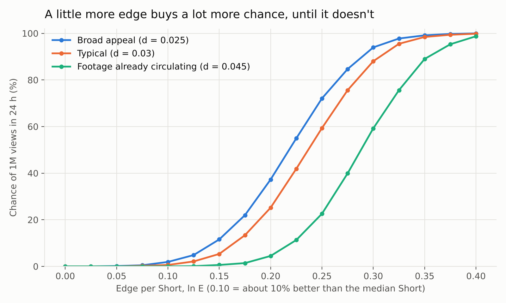

# Edited footage vs. animated Shorts: the maths

This builds on the model in `README.md`. "Edited footage" means real footage (yours, stock, or other people's clips) cut to a beat or a voice-over. "Animated" means drawn, 2D/3D or AI-generated animation.

## The short answer

Nothing public says the Shorts ranker scores a format as such. There is one exception, originality, covered in §4. A format only changes the **inputs** to the cascade:

| input | what it is | where format shows up |
|---|---|---|
| `μ` | average edge per Short, ln E against the median competitor | which signals the format is good at (§1) |
| `σ` | spread of edge across your Shorts | how hit-or-miss the format is |
| `d` | edge lost per wider audience ring | broad vs. niche appeal, **plus viewers who have already seen the footage** |
| `h` | production hours per Short | how many tries you get |
| `π` | edge lost to down-ranking | **re-uploaded footage, since October 2026** |

The master formula:

```
million-view hits per 100 hours  =  (100 / h) × P̄
P̄  =  average over your Shorts of  P( 24 h views ≥ 1M  |  ln E − π,  d )
```

`P` is the S-curve the cascade produces, because `ln(views) ≈ c + κ(ln E)²/(2d)`:



Everything below is that curve read five ways. Every number comes from `python3 model.py formats` (full output in `formats-output.txt`). The constants are illustrative, as in the README, but the directions hold up.

## 1. Where each format tends to get its edge

The edge is a sum of four log-ratios: viewed rate, APV, watch time and engagement. The two formats tend to load them differently. These are tendencies to **check in your own Studio**, not data:

| signal | edited footage tends to | animation tends to | why |
|---|---|---|---|
| viewed rate (hook) | **win** when the footage is spectacular | depend on the first frame and first line | real moments carry their own hook; a drawing has to earn it |
| APV, loops | **win**: short, beat-cut, loopable | lose: stories end, and endings don't loop | a 12 s clip replays; a 36 s story finishes |
| watch time per viewer | lose: short | **win**: longer, and people stay for the story | |
| engagement (comments, shares) | lower, apart from "is this real?" comments | **win** on emotional, original stories | people share stories, and react to clips |

Which format has the higher `μ` *for you* is the one number the maths cannot supply. `compare` (bottom of this page) measures it from your history.

## 2. Quality vs. volume: it depends where you are on the curve

Animation usually costs more hours per Short. To break even on hits per hour, a format that makes `r` times fewer Shorts needs `P(μ_a) = r · P(μ_e)`. Because the curve is steep at the bottom and flat at the top, the extra edge required is:

| other format's ln E | its P(1M) | extra edge needed at r = 3 | r = 5 | r = 10 |
|---|---|---|---|---|
| 0.10 | 0.6% | +0.022 | +0.033 | +0.052 |
| 0.15 | 5.3% | +0.033 | +0.053 | +0.092 |
| 0.20 | 25% | +0.075 | never | never |
| 0.25 | 59% | never | never | never |

- **When hits are rare (most channels), a little extra quality outweighs a lot of volume.** About 5% more edge per Short makes up for making 10× fewer.
- **When hits are already common, volume wins.** No amount of quality makes up for 5× fewer tries once each Short has a 25% chance.

## 3. Spread: hit-or-miss beats consistent, until it doesn't

Same average edge, different spread (d = 0.03):

| mean ln E | sd 0 | sd 0.05 | sd 0.10 | sd 0.15 |
|---|---|---|---|---|
| 0.10 | 0.6% | 3.3% | 11.6% | 19.5% |
| 0.20 | 25% | 33% | 39% | 41% |
| 0.30 | 88% | 81% | 71% | 66% |

Below the bend of the S-curve, P is convex, so **variance is worth more than average**: at mean 0.10 a hit-or-miss format gets 30× the hits of a consistent one. Above the bend it flips. Edited footage built on found moments is naturally spiky, because some clips are incredible and most aren't. An animated series with a consistent craft is steadier. So **a spiky format suits a channel that isn't hitting yet, and a consistent one suits a channel that is.**

## 4. Two penalties that only hit edited footage

**Saturation (higher `d`).** Say the share of each wider audience ring who have already seen this exact footage grows by `φ₁` per ring, and those viewers swipe away. Then the viewed rate in ring k falls by about `φ₁·k`, so

```
d_effective  ≈  d + φ₁
```

| mean ln E | d 0.025 | 0.03 | 0.04 | 0.05 | 0.06 |
|---|---|---|---|---|---|
| 0.20 | 37% | 25% | 8.9% | 1.7% | 0.3% |

Going from d = 0.03 to 0.05 corresponds to 2 points more "already seen it" per ring, and it cuts the chance of a million **15×**. Footage that is circulating on TikTok, Reels and X costs you here. Original animation and your own exclusive footage have `φ₁ = 0`.

**Originality down-ranking (`π`).** On 1 October 2026 YouTube said it is updating Shorts recommendations to "further prioritize original content". "Channels identified as primarily aggregating or re-uploading other creators' videos without significant changes will likely see less distribution". Minor technical or template edits don't count as changes. In Creator Insider's explanation, as reported by Search Engine Journal, a voice-over that just describes what's on screen doesn't either. A flat penalty on the edge gets **squared** like everything else:

| penalty (ln E lost) | P(1M), mean 0.20 | median 24 h views |
|---|---|---|
| 0 | 25% | 192k |
| 0.025 | 13% | 76k |
| 0.05 | 5.3% | 34k |
| 0.10 | 0.6% | 7.2k |

A penalty of only 0.05 cuts the median 5.7×. YouTube publishes no size for the penalty, and the wording ("primarily", "likely") points to a channel-level judgement. Treat the table as the shape of the risk, not its measured size.

**After the views (does not change reach).** A Short longer than 1 minute with a Content ID claim is **blocked**, which makes P zero. Claims send the revenue to the rights holder. YPP's reused-content policy judges how much you transformed the footage. The "inauthentic content" policy (renamed in July 2025) excludes mass-produced or templated content from monetisation. **That one applies to templated AI animation pipelines too**, not just to edited footage.

## 5. Worked example (assumptions, not data)

Every input below is a guess, chosen to reflect §1-§4. "Early" shifts every format's edge down by 0.08, for a channel still finding its feet. "Hitting" uses the edges as listed.

| format | ln E | sd | d | penalty | hours | P(1M) early | P(1M) hitting | hits/100 h early | hits/100 h hitting |
|---|---|---|---|---|---|---|---|---|---|
| Edited: sourced clips, real edit | 0.12 | 0.10 | 0.040 | 0 | 1.5 | 2.2% | 8.8% | **1.49** | **5.84** |
| Edited: aggregator-style reposts | 0.12 | 0.10 | 0.050 | 0.05 | 1.0 | 0.4% | 1.9% | 0.37 | 1.90 |
| Edited: own footage | 0.12 | 0.10 | 0.030 | 0 | 4.0 | 4.4% | 15.8% | 1.11 | 3.95 |
| Animated: hand-made | 0.18 | 0.06 | 0.025 | 0 | 12.0 | **7.2%** | **34.9%** | 0.60 | 2.91 |
| Animated: AI-assisted | 0.15 | 0.07 | 0.030 | 0 | 3.0 | 2.7% | 17.5% | 0.90 | **5.83** |

What holds up across both regimes:
- **Per Short, original animation has the best odds.** It has no saturation, no penalty, and broad stories keep `d` low.
- **Per hour, cheap production wins**, as long as it is genuinely edited or genuinely original.
- **Reposting other people's footage comes last everywhere**, 3-5× behind the same footage properly edited. Saturation and the originality penalty both get squared.
- **Animation's real lever is hours per Short.** Hand-made animation at 12 h needs about +0.045 more edge per Short than a 1.5 h edit to break even (§2, r = 8, in the rare-hit regime). Reusable characters, backgrounds and a recognisable style cut `h` without raising `d`. That is also how to stay clear of "templated", which is a monetisation risk.

For **Map From Memory**: it is an original, universal story (low `d`, likely strong engagement), so its path to a million runs through the hook. It's 36 s with almost no motion (1.6/255 frame-to-frame change against a 6.8 median for human-made films, in `film/NOTE.md`), so the first 1-2 seconds have to stop the swipe on their own. Whether low motion costs viewed rate is a hypothesis to test, not a known effect.

## Run it on your channel

```bash
python3 model.py formats                  # tables A-F above + the chart
python3 model.py compare shorts.csv       # your own format comparison
python3 model.py compare shorts.csv --threshold 100000
```

`shorts.csv` needs one row per Short with `format`, `views_24h` and optionally `hours` (production time). For each format it reports the median, the spread of log views, the observed hit rate, a log-normal tail estimate of the hit rate (a floor, since the model's tail is heavier), and hits per 100 production hours. Fifteen or more Shorts per format gives a usable read. Edit `EXAMPLE_FORMATS` in `model.py` to rerun the worked example with your own guesses.

## Sources

- YouTube, "Prioritizing original content on Shorts" (TeamYouTube, Help Community, 1 Oct 2026), as reported by [9to5Google](https://9to5google.com/2026/10/02/youtube-wont-recommend-unoriginal-shorts/), [PPC Land](https://ppc.land/re-uploaded-shorts-lose-reach-as-youtube-favours-original-clips/), [MediaPost](https://www.mediapost.com/publications/article/418489/youtube-updates-shorts-experience-to-focus-on-orig.html), [Dexerto](https://www.dexerto.com/youtube/youtube-cracks-down-on-clipping-channels-in-shorts-update-prioritizing-original-content-3415700/)
- [YouTube channel monetization policies](https://support.google.com/youtube/answer/1311392) (reused content; inauthentic content). July 2025 rename coverage: [PPC Land](https://ppc.land/youtube-clarifies-inauthentic-content-policy-changes/), [Plagiarism Today](https://www.plagiarismtoday.com/2025/07/08/youtube-targets-inauthentic-content/)
- [YouTube Shorts monetization policies](https://support.google.com/youtube/answer/12504220) (Shorts over 1 minute with a Content ID claim are blocked; revenue sharing)
