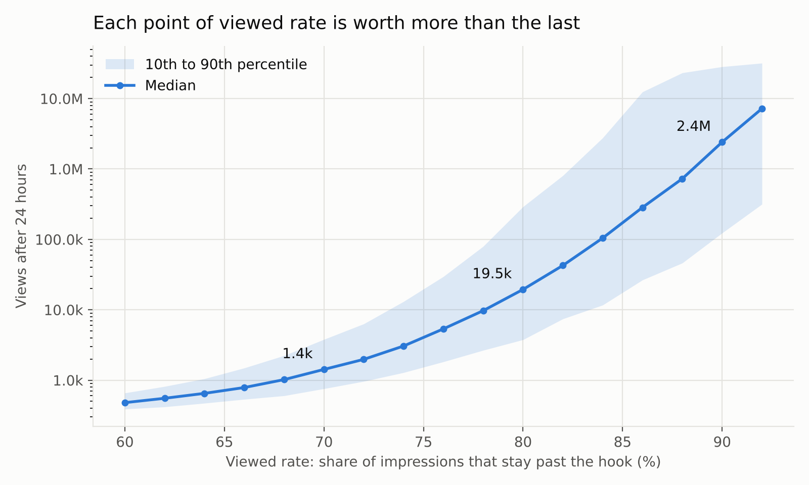
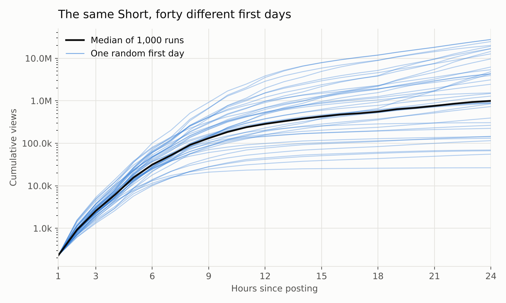
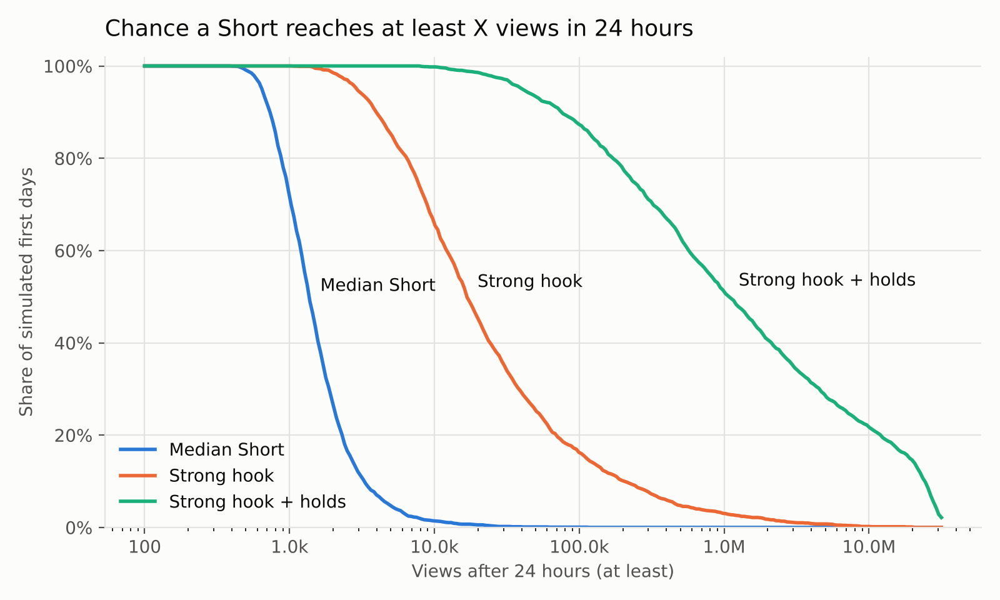

# The mathematics of a YouTube Short's first 24 hours

A working model of how a Short goes from its first few hundred views to millions in a day, with the equations, a simulator (`model.py`) and a way to fit it to your own channel.

**Edited footage vs. animation:** see [`FORMATS.md`](FORMATS.md).

## What is known and what is modelled

**Known (public):**
- Since 31 March 2025, a Shorts view counts **every time a Short starts or replays**, with no minimum watch time. The old definition lives on as "engaged views" in Advanced mode.
- Studio shows **Viewed vs. Swiped away** for Shorts: the share of people who kept watching rather than swiping past.
- YouTube's published ranking research scores each impression on several predicted behaviours (watch time, clicks, likes, dismissals and so on) and combines them into one number. See Covington et al. 2016 and Zhao et al. 2019.
- Early views predict later views well on a **log** scale (Szabo & Huberman 2010), and YouTube view histories fall into a small number of growth and decay classes (Crane & Sornette 2008).

**Not known:** the Shorts ranking weights, how big the first test batch is, how often the system re-decides, and how sharply it favours winners. YouTube publishes none of these. Benchmark figures you see online, such as "70% viewed or you're dead", come from tool vendors, and they contradict each other.

So everything below is a **model**. Each part is consistent with the public facts. The constants are illustrative, and the code makes them easy to change. What holds up is the **shape** of the results. The exact numbers do not.

---

## 1. One impression: what a single swipe is worth

A viewer is shown your Short. Let

| symbol | meaning | Studio name |
|---|---|---|
| `v` | probability they stay past the hook | Viewed (vs. swiped away) |
| `μ` | per-second chance they leave after that | shape of the retention curve |
| `L` | length in seconds | |
| `q` | probability someone who finished plays it again | (shows up as APV > 100%) |

Retention among those who stayed is `S(t) = e^(−μt)`. Then:

```
finish rate (of stayers)     c   = e^(−μL)
one pass, mean fraction          = (1 − e^(−μL)) / (μL)
replays per stayer               = c · q / (1 − q)                (geometric loops)
APV (avg % viewed, per stayer)   = (1 − e^(−μL)) / (μL)  +  c·q/(1 − q)
public views per impression      = 1 + v · c·q/(1 − q)            (every start + every replay)
watch seconds per stayer         = L · APV
```

Two consequences:

- **The view counter is mostly an impression counter.** At the median (v = 70%, 30 s, μ = 0.03/s, q = 10%) each impression produces 1.03 public views. **So views are really impressions. The real question is why the system hands you more impressions.**
- **Length trades APV against total watch time.** With the same hook and the same drop-off per second:

| length | finish | APV | watch s / stayer |
|---|---|---|---|
| 10 s | 74% | 95% | 9.5 |
| 15 s | 64% | 88% | 13.1 |
| 20 s | 55% | 81% | 16.3 |
| 30 s | 41% | 70% | 21.1 |
| 45 s | 26% | 58% | 26.0 |
| 60 s | 17% | 48% | 28.9 |

Which length "wins" depends on how YouTube weighs APV against watch time, and those weights are not public. Under the illustrative weights in `model.py` the best length is 15-20 s. Your own retention curve (μ) moves that point more than any rule of thumb.

## 2. The score, and why a small edge buys a big share

The ranker turns predicted behaviour into one score per (viewer, Short). Relative to the median Short competing for the same viewer, write the **edge** as a weighted sum of log-ratios:

```
ln E = w_v·ln(v/v*) + w_a·ln(APV/APV*) + w_w·ln(watch/watch*) + w_e·ln(engage/engage*)
```

Starred values are the competing median. Because these are logs, **improvements multiply**: being 10% better on two signals is worth about 1.1 × 1.1, not 1.1 + 1.1.

A feed slot goes to the best-scoring candidate. If each candidate's score for a given viewer is its log-value plus random noise, and that noise follows a Gumbel distribution with scale β, then the chance of winning the slot is a softmax:

```
P(your Short wins) = E^κ / Σ (competitors' E^κ),    κ = 1/β
```

Compared with a median Short, your win rate is therefore **`R = E^κ`**. With κ = 6:

| your edge E | R (impression multiplier) |
|---|---|
| 0.90 (10% worse) | 0.53 |
| 1.05 | 1.34 |
| 1.10 | 1.77 |
| 1.20 | 2.99 |

So a 10% edge in quality buys you 77% more slots. **Ranking turns small quality differences into large differences in distribution.** This is the first amplifier.

## 3. The cascade: test, measure, expand

The system serves a batch of `n₀` impressions (subscribers plus exploration), measures, and sizes the next batch by the result. Each new batch has to reach a wider and less well-matched audience, and novelty fades, so the edge erodes by `d` per cycle:

```
n_{k+1} = n_k · R_k,      ln R_k = κ(ln E − d·k) + noise
```

Write `a = κ ln E` and `b = κ d`. Then `ln n_k = ln n₀ + a·k − b·k(k−1)/2`, which is a parabola in k. That gives three closed-form results.

**Growth peaks at cycle** `k* ≈ ln E / d`.

**Total impressions in the day:**
```
ln(N / n₀)  ≈  κ · (ln E)² / (2d)  +  ½ ln(2π / (κd))
```

**If E ≤ 1, it never takes off:** `N ≈ n₀ / (1 − R)`, a small multiple of the first batch.

The key fact is that **the log of your views is quadratic in your edge.** If you double the edge, the exponent grows fourfold:

| edge | ln E | peak cycle | multiplier on the first batch |
|---|---|---|---|
| 14% better | 0.134 | 4.5 (≈ hour 9) | × 6 |
| 31% better | 0.268 | 8.9 (≈ hour 18) | × 1,316 |

With κ = 6, d = 0.03 and 2-hour cycles, twice the edge gives **about 220× the views**. This is the second amplifier. It is also why views are spread so unevenly: near-identical Shorts land at 1,000 and at 1,000,000.

`d` is a property of the content too. A niche Short (high `d`) loses its edge quickly as the audience widens. A broadly appealing one (low `d`) keeps it. Reach depends on `(ln E)² / d`, so **quality and breadth both count**, and neither is enough without the other.

In the simulator, sweeping only the viewed rate (everything else at the median):



| viewed | 24 h views (median) | grows until about |
|---|---|---|
| 70% | 1.4k | it never takes off |
| 75% | ~4k | hour 4-5 |
| 80% | 19.5k | hour 9 |
| 85% | ~170k | hour 13 |
| 90% | 2.4M | hour 17 |

## 4. Luck: the first gate is a small sample

The system judges you on the first few hundred impressions. How many does it need to tell your viewed rate apart from a 70% median? At 95% confidence and 80% power:

```
n ≈ ( z_α·√(p₀(1−p₀)) + z_β·√(p₁(1−p₁)) )² / (p₁ − p₀)²
```

| your true viewed rate | impressions needed to tell it from 70% |
|---|---|
| 72% | ~3,200 |
| 75% | ~500 |
| 80% | ~120 |
| 85% | ~50 |

A clearly better Short is visible in about 100 impressions. A slightly better one sits inside the noise. **And whatever the first batch's measurement error is, κ multiplies it.** With 300 impressions the noise in `ln R` at the first gate is about ±0.35, which means the next batch is anywhere from 0.7× to 1.4× its fair size, before any real difference between Shorts.

The same Short (viewed 80%, retention and engagement a little above median), simulated 40 times:



Its 24-hour outcomes span **75k (10th percentile) to 1.1M (median) to 24M (90th percentile)**, a 300× range from luck alone. The runs fan out between hours 3 and 10, which is when the early gates compound.



| Short | median 24 h | P(≥ 100k) | P(≥ 1M) |
|---|---|---|---|
| Median Short | 1.4k | 0.1% | 0.0% |
| Strong hook (80% viewed) | 16.8k | 16% | 3% |
| Strong hook + holds | 1.1M | 87% | 51% |

This is why **volume is part of the math.** A Short with a 3% chance at 1M has a 46% chance of at least one hit in 20 tries (`1 − 0.97²⁰`) and 78% in 50.

## 5. The 24-hour clock

**Cycles are paced by audience activity.** A cycle ends when its batch has been served, so it runs faster when your audience is awake. Over a full 24 hours the total activity is the same whatever time you post. In this model, **posting time changes your hour-2 number by about 5× but your 24-hour number barely at all**:

| posted | median at 2 h | median at 24 h |
|---|---|---|
| 04:00 | 239 | 1.1M |
| 10:00 | 181 | 1.1M |
| 18:00 | 925 | 1.1M |

The practical rule: **don't compare early numbers between Shorts posted at different times of day.**

**How much of the 24-hour total is known early?** These are log-log fits across 3,000 simulated Shorts of mixed quality:

| known at | R² | 80% of Shorts land within |
|---|---|---|
| first-batch rate metrics (viewed, APV, engagement) | 0.80 | ×/÷ 10.9 |
| views at 1 h | 0.21 | ×/÷ 118 |
| views at 2 h | 0.80 | ×/÷ 10.8 |
| views at 3 h | 0.85 | ×/÷ 8.1 |
| views at 6 h | 0.92 | ×/÷ 4.5 |
| views at 12 h | 0.99 | ×/÷ 1.9 |

Two lessons:
- **Hour-1 view count tells you almost nothing.** The first batch is about the same size whatever the quality. Within one channel, the **rate metrics** in Studio (viewed vs. swiped, APV) at hour 1 predict as well as the view count does at hour 2.
- **Slopes are above 1** (3.5 at 3 h, 1.6 at 6 h). A Short that is ahead early does not just stay ahead; it pulls further ahead, because it is compounding at a higher rate.

## 6. Shares: allocation, not contagion

In epidemic terms, sharing as a direct channel has a reproduction number of

```
R_share = viewed × share rate × views per share  ≈  0.7 × 0.004 × 3  ≈  0.008
```

That is far below the R = 1 threshold, so direct shares add less than 1% to views. **A Short does not go viral by spreading person to person. It goes viral by winning the feed's allocation, cycle after cycle.** Shares still matter, but as a ranking signal inside `ln E`, not as a channel.

## 7. What to do with this

1. **The hook is the biggest lever.** The viewed rate enters the edge directly, and the edge enters the exponent squared. Going from 70% to 80% viewed is worth about 14× in the median.
2. **Fix all four signals.** They add in log space, so adding retention, loops and engagement on top of a strong hook took the median from 16.8k to 1.1M.
3. **Read hour 1 through rates, not views.**
4. **Ship more.** Luck at the first gate is real, and the payoff is so skewed that the number of tries matters.
5. **Breadth matters as much as quality.** A Short that only works for its first audience peaks early, however good it is.

For the **Map From Memory** short in `film/`: trimming the 1.67 s end hold (36.67 → 35.0 s) lifts the finish rate from 33% to 35% under a 0.03/s hazard. That is real, but small. The first 1-2 seconds, which decide the viewed rate, are worth far more.

## 8. Run it, and fit it to your channel

```bash
python3 model.py demo                           # every table above + the three charts
python3 model.py one --viewed 0.78 --length 22  # one Short: percentiles at 1, 3, 6, 12, 24 h
python3 model.py fit history.csv --early views_2h --late views_24h --now 900
python3 model.py formats                        # edited footage vs animation (FORMATS.md)
python3 model.py compare shorts.csv             # per-format hit rates from your history
```

`fit` takes a CSV of your past Shorts (one row each, any column names) and fits `ln(V₂₄) = a + b·ln(V_early)` on your own data. It prints the band 80% of your Shorts land in, and, with `--now`, the forecast for the Short you just posted. Use your own history, because seed size and audience differ by channel.

Set `POOL` in `model.py` to your channel's medians. The model only ever uses a Short *relative* to that pool, so this is the one input that makes the numbers yours.

All constants (`kappa`, `fit_decay`, `cycle_hours`, `seed`, the score `weights`) are in `Platform` with one-line explanations. `demo-output.txt` is the full output at the defaults.

## Limits

- κ, `d`, cycle time, seed size and the score weights are not public. Change them and the numbers move, but the shape does not: log-views quadratic in edge, heavy tails, luck at the first gate, early predictability.
- Viewers are independent in the model. It ignores notifications, search, trends and sounds, remixes, external embeds, and Shorts that revive days later.
- The 24-hour window is just where it stops. A Short still climbing at hour 24 (peak cycle beyond 12) keeps going.

## Sources

- [YouTube changes how Shorts views are counted from March 31 (PPC Land)](https://ppc.land/youtube-changes-how-shorts-views-are-counted-from-march-31/) · [Tubefilter](https://www.tubefilter.com/?p=185419) · [Sprout Social help note](https://support.sproutsocial.com/hc/en-us/articles/35874991211533-YouTube-Shorts-View-Count-Update-March-2025)
- Zhao et al., [Recommending What Video to Watch Next: A Multitask Ranking System](https://research.google/pubs/recommending-what-video-to-watch-next-a-multitask-ranking-system/), RecSys 2019
- Covington, Adams & Sargin, Deep Neural Networks for YouTube Recommendations, RecSys 2016
- Szabo & Huberman, [Predicting the popularity of online content](https://arxiv.org/abs/0811.0405), CACM 2010
- Crane & Sornette, Robust dynamic classes revealed by measuring the response function of a social system, PNAS 2008
- Vendor benchmarks for "viewed vs. swiped" (conflicting, unofficial): [Buffer](https://buffer.com/resources/youtube-shorts-algorithm/), [vidIQ](https://vidiq.com/blog/post/youtube-shorts-algorithm/), [Creator Essentials](https://www.creatoressentials.com/glossary/viewed-vs-swiped-away/)
